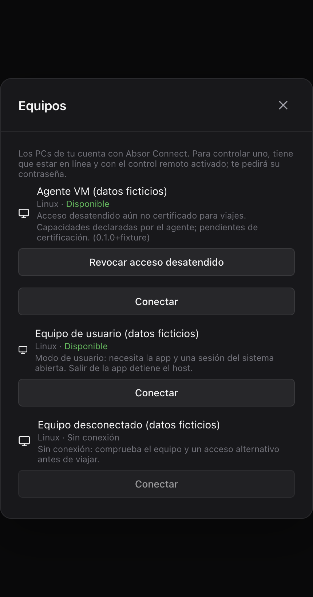

# Acceso remoto y preparación para viajes

Estado del 27/10/2026. La versión publicada 0.4.1 controla escritorios de usuario.
El agente del sistema está en desarrollo. **Todavía no hay una configuración de
Windows, Mac o Mint certificada para acceso desatendido completo.** El backend
aditivo ya admite agentes; una actualización de la API no instala ni activa uno.

## Tres sesiones distintas

- **Sesión de la cuenta de Absor Connect:** permite ver tus equipos y crear una
  solicitud. Su token pertenece a la app; nunca debe copiarse al servicio nativo.
- **Sesión del sistema operativo:** el escritorio de Windows, macOS o Linux.
  El host publicado depende de que esté abierta y de los permisos de ese usuario.
- **Interfaz de Absor Connect:** cerrar su ventana puede dejarla en la bandeja.
  Salir de la app detiene el host publicado. «Abrir al iniciar sesión» arranca
  después de entrar en el sistema, no antes.

El futuro servicio tendrá credencial e identidad propias. Mientras sea el
propietario del host, Electron no debe registrar otro equipo, cambiar su clave
ni recuperar la propiedad al fallar una consulta. La pérdida de red o del
trabajador tampoco devuelve la propiedad. El traspaso local de instalaciones
existentes continúa pendiente: los laboratorios no lo activan automáticamente.

## Lo publicado y lo que sigue pendiente

| Sistema | Host publicado | Pendiente para el servicio completo |
|---|---|---|
| Windows | Escritorio ordinario del usuario, con la app abierta. | Servicio SCM, trabajadores por sesión/escritorio, UAC y aplicaciones elevadas, bloqueo, entrada y paquetes/ACL finales. |
| macOS | Escritorio del usuario con pantalla y Accesibilidad autorizadas. Sonido desde macOS 14.2. | Revisión de viabilidad, identidad/firma del helper, launchd/XPC, permisos y captura/entrada de los contextos de bloqueo e inicio. No se promete autoactualización del helper con firma ad-hoc. |
| Mint/Linux | Host con sesión X11 y app abierta; audio con PulseAudio/PipeWire y `pactl`. Wayland puede controlar otros equipos, pero no actuar como host publicado. | Selección logind/asiento/sesión, LightDM/Cinnamon, captura general, acciones del sistema y paquete `.deb` reversible. |
| Android/iOS | Controladores; no son equipos controlables. | Tras la viabilidad nativa en simulador/emulador: acciones, recuperación tras reiniciar y certificación con los paquetes y dispositivos finales. |

La captura de una ventana propia en una VM no certifica un escritorio completo,
una pantalla protegida, monitores adicionales ni otra versión/arquitectura.
Los resultados reproducibles viven en
[`verification.md`](../openspec/changes/add-unattended-admin-access/verification.md).
La matriz certificada de servicio completo está vacía hasta superar el piloto
con los paquetes finales. Ni «en línea», ni una capacidad declarada por la API,
ni autenticar correctamente equivale a «preparado para viajar».

## Antes de salir

1. Conserva un acceso alternativo que ya hayas probado y una persona que pueda
   intervenir si el sistema no arranca. No dependas del agente en desarrollo.
2. Con el modo publicado, deja abierta la sesión del sistema y Absor Connect en
   la bandeja. Comprueba los permisos y las opciones de energía del host.
3. Desde una red exterior, prueba imagen, ratón, teclado, sonido y el relé.
   Verifica qué ocurre al bloquear: el soporte publicado no incluye esa pantalla.
4. Repite la prueba después de actualizar. No des por conservados los permisos
   del Mac por el mero hecho de haber instalado una versión nueva.
5. No programes cerrar sesión, reiniciar o cambiar el usuario del host como
   prueba si no dispones de recuperación presencial/alternativa.

El cifrado de arranque puede exigir desbloqueo presencial antes de iniciar el
sistema o disponer de red. FileVault, BitLocker y el cifrado de Linux tienen
configuraciones distintas: un servicio dentro del SO no está funcionando durante
el prearranque. No se certifica vuelta remota en esa etapa.

## Equipos, capacidades y revocación

La lista muestra el modo de usuario o la declaración del agente. Un agente aún
no certificado se indica como tal, incluso si la API declara todas sus
capacidades. Datos desconocidos o incompletos tampoco conceden funciones.



En escritorio, **Equipos → Revocar acceso desatendido** confirma el nombre del
equipo desde el proceso principal y da de baja exclusivamente ese ID en la
cuenta actual. Cancelar no envía la baja. Si cambia la cuenta durante el diálogo,
la operación se descarta. El token no llega al renderer. Un error de red no se
presenta como revocación realizada. Al aceptarse, se cierran los visores locales
de ese host; el agente debe cortar sus conexiones en un máximo de 30 segundos.

Después se necesita un alta nueva para reactivar el agente. Esta baja no borra
conexiones S3/SSH, no desinstala binarios ni cambia la contraseña del sistema.
El modelo/API móvil ya reconoce capacidades y la baja del equipo; su control
visual y las pruebas nativas completas siguen pendientes.

### Contexto protegido en el visor de escritorio

Con un host que anuncie la extensión después de autenticar, el visor muestra
escritorio, bloqueo, entrada, autorización, transición o no disponible. Espera
capacidades y contexto válidos; ignora secuencias antiguas. Si no hay imagen
actual, oculta la anterior y lo indica. Al haber imagen, espera un fotograma
posterior a la notificación antes de volver a mostrarla. El host sigue siendo
responsable de aislar la fuente de captura; esto no certifica pantallas del SO.
La entrada en bloqueo/inicio requiere `login`; en autorización, `administration`.
Sin esa capacidad, el visor indica que no admite entrada en ese contexto.

Al cambiar de contexto, suelta entrada, suspende audio/portapapeles/archivos y
borra nombres/rutas visibles del contexto anterior. Cancela esperas de buffer,
colas y descargas pendientes: un diálogo de guardar que vuelva después no
reanuda la descarga. Los mensajes antiguos de contexto tampoco las reactivan.
Como v1 no etiqueta cada trozo de contenido por contexto, estas funciones
sensibles **permanecen suspendidas hasta reconectar**, incluso tras volver al
escritorio. La nueva conexión exige autenticación y estado nuevos. Un host
legado conserva su comportamiento y no recibe negociación administrativa.


El aviso se probó con el visor de producción y dos peers WebRTC locales de
laboratorio. No es una captura real de UAC o inicio de sesión. La integración
visual equivalente del móvil y el aislamiento general en cada host siguen
pendientes de sus propias tareas.

Cuando la API responde `device_agent_owned`, Electron corta su host de usuario,
conserva el identificador, deja de consultar/registrar y guarda el modo de usuario
desactivado. Ajustes no permite modificar esa configuración. Si no puede guardar
el cambio, indica la necesidad de intervención; el corte en memoria sigue vigente.
Tras revocar el agente, reinicia la interfaz para volver a comprobar la propiedad;
el modo de usuario seguirá desactivado y exige activación explícita.

La bandeja distingue «propietario agente, estado sin verificar» de «desactivado».
Salir de la interfaz no envía una orden de parada al agente. Sin un cliente local
de salud verificado, la instalación de actualizaciones queda pospuesta también
al salir: no se interpreta la ausencia de datos como una sesión libre. La parada
local del servicio y la actualización compatible del paquete final siguen pendientes.

Cambiar la contraseña de la cuenta, borrar la cuenta o cerrar/caducar la sesión
que originó el alta invalida la credencial del agente. Cerrar otra sesión de la
cuenta no vinculada al alta no lo revoca. La revocación local inmediata y el
traspaso transaccional desde Electron siguen pendientes de su integración final.

## Recuperación y diagnóstico

- **Host publicado fuera de línea:** comprueba alimentación, red, sesión del
  sistema y app/bandeja mediante el acceso alternativo. Un indicador antiguo no
  demuestra disponibilidad actual. No borres la identidad o los datos de la app.
- **Mac sin permiso:** concédelo localmente en Ajustes del Sistema. No modifiques
  TCC/SIP ni confundas ejecutar como root con disponer de contexto gráfico.
- **Linux/Wayland:** vuelve a una sesión X11 si vas a usar el host publicado.
  No uses `xhost +`, no cambies PAM/LightDM y no ejecutes la AppImage como root.
- **Agente de laboratorio roto:** utiliza únicamente el desinstalador de ese
  laboratorio, documentado en [`agent/linux-secure-lab/README.md`](../agent/linux-secure-lab/README.md).
  Sus archivos y unidades llevan sufijo de laboratorio. No son el paquete final.
  No elimines servicios de escritorio o archivos ajenos para repararlo.
- **Tirones con buena conexión:** observa en el visor ruta directa/relé, RTT,
  fotogramas por segundo, bitrate y búfer. Prueba el perfil «Fluido» y compara
  otra red. Buena velocidad de descarga no demuestra baja latencia, ausencia de
  pérdidas o decodificación rápida. No atribuyas la causa a TURN sin comprobar la
  ruta real. Sigue pendiente certificar iPad → Windows con el agente final.

Los informes públicos deben incluir versiones, transporte, resultado y límites,
no contraseñas, teclas, contenido del portapapeles, imágenes privadas, direcciones
personales ni tokens. Los diagnósticos del núcleo usan datos artificiales:

```bash
cargo test --manifest-path agent/Cargo.toml --locked -p absor-agent-control
cargo run --manifest-path agent/Cargo.toml --locked --example lease-smoke
```

Estos comandos comprueban protocolo/plazos; no instalan servicios ni certifican
el equipo donde se ejecutan. La guía del agente explica las características de
compilación optativas y la separación del IPC:
[`agent/README.md`](../agent/README.md).


## Acciones del visor de escritorio

El menú **Administrar el PC** solo aparece tras autenticar y recibir contexto y
acciones anunciadas por el host. Cada operación pide confirmación con el nombre
del equipo obtenido por main desde la API. Bloqueo, cierre de sesión del sistema,
reinicio y atención segura son operaciones enumeradas: no se envían programas,
rutas ni comandos de terminal. Un host anterior no recibe estas órdenes.

«Aceptada» confirma que el host aceptó la solicitud, no que el SO haya terminado.
Un rechazo no inicia una espera. Si el resultado no llega en quince segundos,
la orden no se reenvía y otra operación exige una conexión nueva. Cambiar de
contexto o retirar una capacidad invalida una confirmación que estaba abierta.

Un reinicio aceptado cierra el contenido de la sesión y descarta K. El visor
consulta la disponibilidad del mismo equipo cada dos segundos, hasta cinco
minutos, sin crear ofertas mientras espera. Se puede cancelar desde el panel
central. Solo considera una presencia nueva tras observar indisponibilidad o
un heartbeat posterior al registrado antes de confirmar. Esa señal no certifica
el reinicio del SO: al volver se pide la contraseña del PC y una prueba nueva.
Cerrar sesión del sistema también exige autenticar de nuevo. La contraseña no
se conserva en el campo al conectar y las teclas de la confirmación son locales.

La prueba de este controlador usa un host artificial y WebRTC real, sin acciones
del SO. El agente nativo de laboratorio sigue sin anunciar operaciones. Los
servicios finales y el piloto de reinicio Windows/Mac/Mint continúan pendientes.
No se anuncia preparación para viajes por el mero hecho de mostrar este menú.


### Preparación mostrada en la app

Ajustes incluye «Preparación para viajes»: el servicio puede responder y tener
una sesión activa sin que esa configuración esté certificada. El catálogo actual
de capacidades certificadas está vacío. Equipos permite desplegar las capacidades
que declara cada agente y diferencia esa declaración de las pruebas del piloto.
Un equipo fuera de línea o con metadatos desconocidos conserva ese aviso.

En modo de usuario, salir de Absor Connect detiene el host y abrir al iniciar
sesión no permite entrar antes del login del SO. Si se ha observado intención
nativa pero no se puede verificar su servicio, la app reserva la propiedad y no
crea otro host. Cerrar la interfaz cancela su consulta, sin enviar una parada al
servicio; esa separación por sí sola no garantiza acceso después de bloquear,
cerrar sesión o reiniciar. Las altas/migraciones y el paquete final siguen pendientes.
